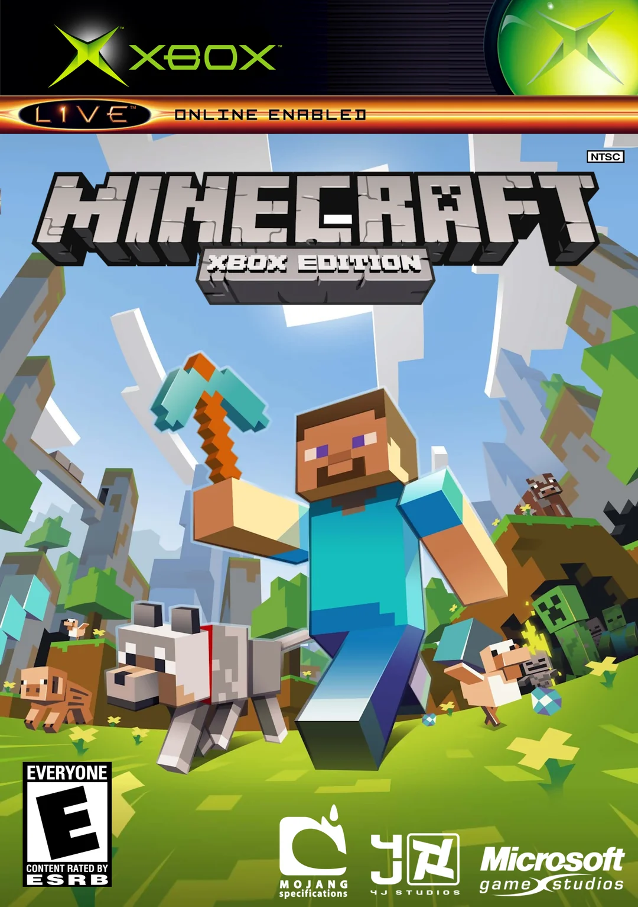
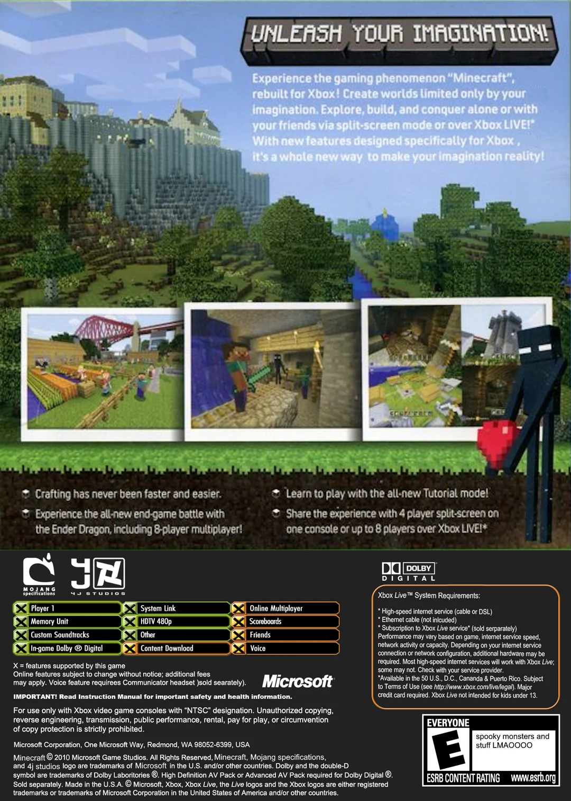

<div align="center">



# OptiCraft Heritage — Original Xbox Edition

**Classic Minecraft (Java 1.2.5 and 1.5.2), running natively on the original 2001 Xbox.**<br>
Legacy console menus, split screen, 720p, Dolby Digital 5.1 and ~60 FPS on a 733 MHz Pentium III with 64 MB of RAM.

[](#-install-on-your-xbox)
[](#-two-versions)
[](#-features)
[](#-features)
[](LICENSE)

[**⬇️ Download**](https://github.com/xeodeo/OptiCraft-Heritage-XBOX-CLASSIC-Edition/releases) ·
[**✨ Features**](#-features) ·
[**🎮 Install**](#-install-on-your-xbox) ·
[**🕹️ Controls**](#%EF%B8%8F-controls) ·
[**🛠️ Build it**](#%EF%B8%8F-building-from-source) ·
[**🙏 Credits**](#-credits)

</div>

---

> [!NOTE]
> **🇪🇸 En español:** Minecraft clásico (Java 1.2.5 y 1.5.2) funcionando de forma nativa en la Xbox clásica, con menús
> estilo consola, pantalla partida, 720p, Dolby Digital 5.1 y unos 60 fps. Descárgalo en
> [Releases](https://github.com/xeodeo/OptiCraft-Heritage-XBOX-CLASSIC-Edition/releases), copia la carpeta al disco
> duro de una Xbox con softmod y ábrela desde el dashboard. También funciona en [xemu](https://xemu.app).

---

## ✨ Features

<table>
<tr>
<td width="50%" valign="top">

### 🖥️ Console experience
- **Legacy console UI** (the Xbox 360 / PS3 look) or the classic **Java UI**, switchable in the options
- **Console crafting menu**, Xbox button icons everywhere
- **2-player split screen** on one console
- **LCE-style skin selector** with skin packs (Halo, Mass Effect, Skyrim) plus a `skins` folder for your own
- **Tutorial world**, achievements, saves on the hard disk

</td>
<td width="50%" valign="top">

### ⚡ Made for the hardware
- **~60 FPS** with fog, clouds, sun and moon (1.5.2 test builds)
- **480p** or **720p progressive** (same game, pick the `_720p` file)
- **Dolby Digital 5.1** or stereo on the MCPX audio chip
- **OptiFine-style video options**: animations, details, quality, performance
- **HUD safe area** slider for TVs that crop the picture

</td>
</tr>
<tr>
<td width="50%" valign="top">

### 🌍 Gameplay
- Full survival and creative, with Java's own world generation
- Nether and The End, with the Ender Dragon
- Redstone, pistons, TNT
- 1.5.2: villagers and trading, desert villages, iron golems, witches, the **Wither**

</td>
<td width="50%" valign="top">

### 🌐 Extras
- **Multiplayer (experimental):** join Minecraft 1.2.5 servers over the console's network connection
- **Built-in launcher:** one `default.xbe` lists the installed versions
- **Normal** and **experimental** builds (the experimental one generates terrain on a worker thread)
- **Network log** for testers: follow the game live from a PC

</td>
</tr>
</table>

---

## 📦 Two versions

| | **Java 1.2.5** | **Java 1.5.2** |
|---|---|---|
| Status | ✅ Stable, in the releases | 🧪 In testing |
| Branch | `xbox-opti-30` (test: `opti30-cruceta`, `opti30-erluza`) | `port152-claude` (test: `port152-aldeanos`, `port152-erluza`) |
| Highlights | The classic, lightest version | Villagers and trading, witches, the Wither, beacons, dyeable wolf collars and more |

The newest work (fixes and optimizations brought in from other OptiCraft forks, the HUD safe area, identical
options in both versions) lives in the `*-erluza` branches until it has been tested on a real console.

---

## 🎮 Install on your Xbox

**You need:** a softmodded or modded original Xbox with FTP access, or [xemu](https://xemu.app) on a PC.

1. Download the latest zip from [**Releases**](https://github.com/xeodeo/OptiCraft-Heritage-XBOX-CLASSIC-Edition/releases).
2. Copy the `OptiCraft` folder to the console's hard disk, for example `F:\Games\OptiCraft\`:

   ```text
   OptiCraft\
   ├── default.xbe            ← the launcher: lists the versions below
   ├── 1.2.5\
   │   ├── OptiCraft.xbe          480p
   │   ├── OptiCraft_720p.xbe     720p progressive
   │   ├── OptiCraft_exp.xbe      experimental, 480p
   │   ├── OptiCraft_exp_720p.xbe experimental, 720p
   │   └── assets.pak             textures, sounds, music
   └── 1.5.2\
       └── (same files)
   ```

3. Launch `default.xbe` from the dashboard and pick a version.

> [!TIP]
> **720p** needs component video and 720p enabled in the dashboard's video settings. If the HUD is cut off at the
> edges of your TV, open **Options → Video → Safe area**.

Saves and `options.txt` go to `E:\TDATA\FFFF4F43\`. In **xemu**, load the `.iso` as the DVD.

---

## 🕹️ Controls

<table>
<tr><th>In game</th><th>In menus</th></tr>
<tr>
<td valign="top">

| Button | Action |
|---|---|
| Left stick | Move |
| Right stick | Look |
| A | Jump |
| Y | Inventory |
| B | Drop item |
| Left stick click | Sneak (hold or toggle) |
| LT / RT | Use / attack |
| White / Black | Change hotbar slot |

</td>
<td valign="top">

| Button | Action |
|---|---|
| D-pad / stick | Navigate |
| A | Select (hold to take one by one) |
| B / Y | Back |
| X | Delete the highlighted world |
| Left / right | Sliders, side-by-side buttons |

</td>
</tr>
</table>

Every binding, including the D-pad and the sticks, can be changed in **Options → Controls**.

---

## 🖼️ Cover art

<div align="center">



<sub>Front and back cover made by <a href="https://www.reddit.com/user/SuperNitro58/"><b>u/SuperNitro58</b></a> on Reddit. Thank you! 💚</sub>
</div>

---

## 🛠️ Building from source

<details>
<summary><b>Original Xbox (XDK 5849 + Visual Studio 2022)</b></summary>

<br>

The Xbox build needs the Microsoft Xbox Development Kit. It is **not** included in this repository and must never be
committed to it. The build was developed with **XDK 5849**, preserved in the Internet Archive collection
<https://archive.org/details/xbox-sdks> (archive `2005-03 - 5849.6, 5849.17 - RecoveryEXE, SDK.7z`).

The XDK does not have to be installed (its installer expects Visual Studio .NET 2003 and Windows XP). The build only
uses its headers, libraries and tools, taken straight from the installer's payload:

1. Download the archive above and unpack it with 7-Zip. It contains `XDKSetup5849.17.exe`.
2. Unpack the installer itself: `7z x XDKSetup5849.17.exe -o<xdk>\sdk`. The XDK ends up in `<xdk>\sdk\XDK\xbox`
   (`bin\`, `include\`, `lib\`).
3. Point `XBOX_XDK_ROOT` at that folder.

Other requirements:

- **Visual Studio 2022** with the C++ x86 tools and the Windows 10 SDK.
- **[extract-xiso](https://github.com/XboxDev/extract-xiso)** on `PATH` (or `-DXBOX_EXTRACT_XISO=...`).
- **Game data** (`assets/`, `resources/`), not in the repository. Copy it into `data/` at the repository root, or pass
  `-DXBOX_DATA_DIR=...`.

```text
set XBOX_XDK_ROOT=C:\path\to\xdk\5849\sdk\XDK\xbox
cmake --preset xbox-release
cmake --build --preset xbox-release
```

The output lands in `bin/xbox/`: `iso/` is the folder for the console, `OptiCraft.iso` is for xemu.

| | Test build | Public build |
|---|---|---|
| Preset | `xbox-release` (add `-DXBOX_NETLOG_HOST=<your PC's IPv4>`) | `xbox-public` |
| Output | `bin/xbox/` | `bin/xbox-public/` |
| Network log | every log line goes over UDP to that PC: `python scripts/xbox/tools/escuchar_log.py` | none |

Tested with Windows 10 22H2, Visual Studio 2022 17.14 (MSVC 14.44), Windows SDK 10.0.26100, CMake 3.31, Ninja 1.13,
XDK 5849, extract-xiso 2.7.1, xemu 0.8.136 and a softmodded retail console.

**How the hybrid toolchain works.** The XDK's own compiler (Visual C++ 7.1) cannot build C++17, so the game is
compiled with the VS2022 `cl.exe` (32-bit, `/arch:SSE`, since the Pentium III has no SSE2) and linked with the XDK's
linker against the modern static CRT plus the XDK libraries. `src/xbox/runtime/` replaces the XDK startup and the Win32
imports the modern CRT expects, and two post-link scripts mark the PE as an Xbox image and rewrite the few SSE2
instructions the prebuilt CRT contains, which a real console would fault on.

The full write-up (setup, toolchain internals, every adaptation to the shared code, debugging, known issues and how the
port was done step by step) is in **[docs/XBOX_PORT.md](docs/XBOX_PORT.md)**.

</details>

<details>
<summary><b>PC, PlayStation 2 and Nintendo Wii (inherited from OptiCraft Heritage)</b></summary>

<br>

CMake 3.21 or newer; presets are in `CMakePresets.json`.

| Target | Configure and build |
|---|---|
| PC | `cmake --preset gcc-release` then `cmake --build --preset gcc-release` |
| PC 32-bit / legacy | `build_gcc32.bat legacy` (set `OPTICRAFT_MSYS2_ROOT` for another MSYS2 install) |
| PlayStation 2 | `cmake --preset ps2-release` then `cmake --build --preset ps2-release` (USB folder `mass:/OptiCraftHeritage/`) |
| Nintendo Wii | `cmake --preset wii-release` then `cmake --build --preset wii-release` (Homebrew Channel folder `apps/OptiCraft/`) |

</details>

<details>
<summary><b>Source layout</b></summary>

<br>

```text
src/
  client/      client-side shared code
  java/        Java compatibility/runtime helpers
  net/         game implementation
  platform/    shared platform interfaces and backend selection
  xbox/        original Xbox: D3D8 renderer, XInput, DirectSound, XNet, runtime glue
  pc/ ps2/ wii/  other platforms
cmake/         toolchains and platform build logic
scripts/xbox/  post-link patches, artwork, debugging tools
external/      third-party dependencies
```

Each platform selects exactly one implementation per backend, so platform code never leaks into another target.

</details>

<details>
<summary><b>Working on this fork</b></summary>

<br>

The context of the work (notes, guides, tools and how to restore everything) is in the
[`contexto`](../../tree/contexto) branch (see `RESTAURAR.md`). Resources used but not stored here: the Legacy Console
Edition sources, used as the reference for the console interface (<https://archive.org/details/minecraft_20260301>),
and the XDK (<https://archive.org/download/xbox-sdks>).

</details>

---

## 🙏 Credits

- **[xeodeo](https://github.com/xeodeo)**: the original Xbox port.
- **OptiJuegos and the OptiCraft Heritage contributors**: the C++ engine this port is built on, and the PS2/Wii work.
- **The erluza OptiCraft fork**: stability fixes and optimizations brought into both versions.
- **[u/SuperNitro58](https://www.reddit.com/user/SuperNitro58/)**: the cover art.
- **[xemu](https://xemu.app)** and **[XboxDev](https://github.com/XboxDev)** (extract-xiso): the tools that made testing possible.

<div align="center">

<sub>This project is not affiliated with, endorsed by, or sponsored by Mojang Studios or Microsoft.
Minecraft is a trademark of Mojang Studios; Xbox is a trademark of Microsoft. The XDK and the game assets are not
distributed with this project. Third-party libraries under <code>external/</code> keep their own licenses.</sub>

<br><br>

**Made with 💚 for the original Xbox.**

</div>
